# Spectre

Spectre is an Elixir framework for agents: a **Stack** installs capabilities, an
**Agent** recognizes intentions, and a **Server** implements application behavior
inside an OTP process. The Governed Act Model (**GAM**) mediates the operations
that the application declares consequential.

**0.4.0 development branch:** this README describes `feature/agent-server-gam`;
it is not
an announcement of a published Hex release. Existing applications should read
[Migration from 0.3](docs/MIGRATING_TO_0_4.md).

## Install

Requires Elixir `~> 1.19`.

```elixir
{:spectre, github: "elchemista/spectre", branch: "feature/agent-server-gam"}
```

Run `mix deps.get` and commit `mix.lock`. Use an exact reviewed `ref:` for a
reproducible deployment. [Installation](docs/INSTALLATION.md) lists the compatible
companion branches and supervision setup.

## A minimal agent

No model, database or external service is needed for this example:

```elixir
defmodule MyApp.AI do
  use Spectre.Stack
end

defmodule MyApp.SupportServer do
  use Spectre.Server, tools: MyApp.AI

  def handle_flow({:support, :pricing}, _input, ctx),
    do: respond(ctx, "Plans start at EUR 20 per month.")

  def handle_flow(:unmatched, _input, ctx),
    do: respond(ctx, "Ask me about pricing.")
end

defmodule MyApp.SupportAgent do
  use Spectre.Agent, stack: MyApp.AI, server: MyApp.SupportServer
  router(strategies: [:regex])

  flow :support do
    on(:pricing, regex: ~r/\b(price|pricing|cost)\b/i)
  end
end

{:ok, server} = Spectre.Server.start_link(agent: MyApp.SupportAgent, consumer: self())
{:ok, interaction} = Spectre.Server.input(server, "What is the price?")

receive do
  {Spectre.Server, ^server, {:response, ^interaction, text, _metadata}} ->
    IO.puts(text)
end
```

`input/3` returns an interaction ID; replies arrive asynchronously at the
consumer. In an application, supervise the Server or use `Spectre.summon/1`
for per-subject ownership. [Getting started](docs/GETTING_STARTED.md) covers
these next steps and the generator.

## From conversation to governed work



[Diagram source](docs/assets/readme-architecture.mmd).

Server helpers return commands in the Context. `on_result:` names the callback
continuation. Models, classifiers and tools run in workers; native OTP callbacks
remain available in the same conversation owner.

Configure permitted effects through `gam: [operations: ...]`. Confirmation,
when required, binds the human's decision to the exact presented operation.
Installing a tool or receiving a model proposal does not grant authority.
Mounted Skill servers have independent state and workers while sharing their
root AgentServer's GAM Domain and the mount's restrictions.

RAM-only operation is supported. Ledger can persist canonical GAM history,
Server coordination and the Domain's historical projection in the application's
PostgreSQL database. Application payload callbacks choose where content is stored
and how it is protected.

## Example: ask before sending an email

After registering the email effect, configure the operation on the root:

```elixir
# Options for Spectre.Server.start_link/1; the application authenticates the user.
identity: %{subject: user.id},
consumer: chat_process,
gam: [operations: %{{:kinetic, :send_email} => [confirm: true]}]
```

The business callback proposes the concrete draft instead of sending it directly:

```elixir
def handle_flow({:mail, :send}, _input, ctx) do
  propose(ctx, {:kinetic, :send_email},
    %{"to" => ctx.assigns.recipient, "body" => ctx.assigns.draft},
    on_result: :sent)
end

def handle_result(:sent, {:governed, %{outcome: %{status: :succeeded}}}, ctx),
  do: respond(ctx, "The mail service confirmed the send operation.")
```

These are application fragments: the effect registration, draft preparation and
chat consumer are supplied by the host. The consumer displays the exact draft,
acknowledges rendering and submits the human's separate confirm/reject decision.
GAM checks that decision before execution. [Managed GAM](docs/MANAGED_GAM.md)
shows those calls; [the full outreach source](https://github.com/elchemista/spectre/blob/feature/agent-server-gam/docs/examples/outreach_agent.exs)
connects website inspection, drafting, refusal and failure handling.

## Guides

| Goal | Start here |
| --- | --- |
| Build and run an agent | [Getting started](docs/GETTING_STARTED.md) |
| Understand processes, Context and continuations | [Architecture](docs/ARCHITECTURE.md), [Server](docs/AGENT_SERVER.md) |
| Add models, browser, memory and other packages | [Stack tools](docs/STACK_TOOLS.md) |
| Require local or external human consent | [Managed GAM](docs/MANAGED_GAM.md), [external approval](docs/EXTERNAL_APPROVALS.md) |
| Configure persistence and content storage | [Domain storage](docs/DOMAIN_STORAGE.md), [payload storage](docs/PAYLOAD_STORAGE.md) |
| Run parallel reusable capabilities | [Skills](docs/SKILLS.md) |
| Run a complete website-to-email workflow | [Examples](docs/EXAMPLES.md), [LiveView demo](docs/DEMO.md) |
| Deploy, test or migrate | [Production](docs/PRODUCTION.md), [Testing](docs/TESTING.md), [Migration](docs/MIGRATING_TO_0_4.md) |

The [documentation index](docs/START_HERE.md) links the full 0.4 reference.
Earlier Instance/Run APIs remain supported through the
[compatibility reference](docs/COMPATIBILITY.md). The
[GAM manifesto](https://spectre.guide/en/governed-act-model) explains its authority
model; [GAM in Spectre](docs/GAM.md) maps it to the implementation.

[Contributing](CONTRIBUTING.md) · [Security](SECURITY.md) · [Changelog](CHANGELOG.md) ·
[Application authoring reference](LLMS.md)
