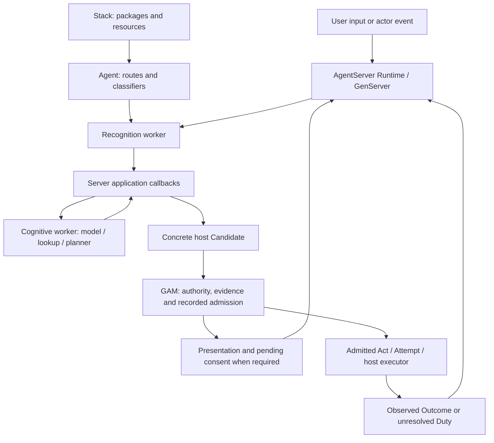

# The Spectre 0.4 system

Spectre separates recognition, application coordination and authority. A Stack
installs capabilities; an Agent declares how inputs are recognized; a Server
implements ordinary Elixir callbacks inside one OTP owner. GAM mediates concrete
consequences on the host's declared governed surface.

The diagram shows logical ownership, not a process per box. The actual
conversation owner is `Spectre.Server.Runtime`; the application module using
`Spectre.Server` is its callback implementation. The GAM Domain owns its own
canonical governed facts. The two journals have distinct jobs.

## Where application code lives

| Concern | Put it here |
| --- | --- |
| Installed packages, model pools, browser/memory resources | Stack declaration and named Stack runtime |
| Intent taxonomy, regex, semantic examples, classifier bindings | Agent |
| Business continuations, unmatched handling, pending policy | Server callbacks |
| Application timers, monitor replies, actor messages | Server native OTP callbacks |
| Durable portable application data | `ctx.assigns` |
| Process-local references | `ctx.private` |
| Credentials and concrete effects | Host resources and admitted executor |
| Authority, scope, evidence, presentation and reconciliation | GAM Domain and host bindings |

Recognition still supports exact examples, embeddings, local and LLM classifiers,
arbitration, custom adapters and fallback. The response model and classifier
need not be the same. Models can remain replaceable without redefining authority.
Read [Routing](docs/ROUTING.md) and [Training](docs/TRAINING.md).

## Installed packages in the loop

Packages extend the existing `Spectre.Stack.Installable` contract with `tools/1`.
Selecting `tools: MyApp.AI` in the Server generates helpers such as `kinetic`,
`mnemonic` and `lens`. Helpers enqueue logical commands; they do not expose live
package structs in Context. Runtime resources are resolved in workers.

| Package | Role in a Server application |
| --- | --- |
| Kinetic | Prepare closed action candidates from consolidated model output. |
| Mnemonic | Recall portable memory; submit explicitly bound writes for governance. |
| Lens | Read browser views with logical references; bind browser actions to host operations. |
| Prism | Select model capabilities and supply the inference extension. |
| Beam | Inspect channels and bind deliveries to host operations. |
| Directive | Reduce mission state and return proposed next work. |
| Pulse | Inspect protocol/contact information and bind outgoing messages. |
| Ledger | Persist Server coordination and inspect only the current checkpoint metadata. |
| Lab | Inspect a current checkpoint inside a worker and return a bounded summary. |

This table describes the companion 0.4 tool adapters, not every legacy package
entrypoint. Package versions are independent. The
[nine-package integration](https://github.com/elchemista/spectre/blob/feature/agent-server-gam/integration/stack_tools/README.md) is executable and
uses real Server/GAM with deterministic external providers. It is not proof of
production browser, email, model or distributed-system behavior.

## Governance means a concrete boundary

The [GAM manifesto](https://spectre.guide/en/governed-act-model) distinguishes
Mandate, Evidence, Act and Duty. A route identifies a handler; a proposal makes
an intended consequence precise; neither supplies authority. The host provides
authenticated scope, candidate/presentation builders, ingress and executors.
[GAM in Spectre](docs/GAM.md) explains that mapping.

Cognition does not require a consent prompt merely because a model is involved.
The declared governed surface may nevertheless include protected information
or resource consumption. Those transitions must use the same boundary wherever
they originate: regex, model output, actor event or application timer.

A successful presentation precedes consent evidence; a committed Act precedes
capability release. An observed Outcome is separate from admission. Unknown
outcomes remain unresolved instead of becoming an automatic retry. Expiring an
intention does not erase an Act, its cause or a Duty.

## Persistence is part of the application protocol

The Server owns a durable inbox/outbox and compares checkpoint revisions. It
acquires returned commands before invoking workers, and acquires results before
delivering continuations. Portable projections contain data, not actor PIDs,
provider clients or model descriptors.

Cognitive operations declare safe or nonrepeatable recovery. Governed recovery
uses the original journal and GAM records. Changed definitions or tool contracts
need an explicit checkpoint migration; old in-flight effects are not silently
reinterpreted under a new adapter.

Ledger's optional ServerStore is a coordination log with atomic compaction and
revision fences. It is distinct from GAM's ledger of governed facts. Installing
Ledger does not merge these responsibilities or make all application writes
GAM Acts.

## Migrating an existing system

0.4 retains the 0.3 router, datasets, training and compatibility runtime APIs.
The ownership change is from Instance-centered orchestration to Agent/Server
for new applications. Legacy policy/Effect workflows, hooks, Skill state,
Work/Vigil and reflection must be audited when moved; they do not acquire GAM
protection simply by installing the new version.

Start with [migration](docs/MIGRATING_TO_0_4.md), [architecture](docs/ARCHITECTURE.md)
and [AgentServer](docs/AGENT_SERVER.md). The complete earlier ecosystem overview
is preserved as [0.3 reference](docs/legacy/SYSTEM_0_3.md).
