# Stack, Agent, Server and GAM

Spectre's AgentServer separates capability declarations, conversation and
authority. One Root coordinates the conversation. It can run reusable Skill
mounts and start independent Activities under the same Managed GAM Domain.

## Responsibilities

| Layer | What it owns |
| --- | --- |
| `Spectre.Stack` | Installed packages, immutable tool and provider bindings, reusable Flow definitions, Activity types and resource declarations. |
| `Spectre.Agent` | Router strategies, selectable flows, classifiers and dataset settings. An Agent without installed capabilities can omit its Stack. |
| `Spectre.Flow.Port` | Reusable, exposed routes and their result callbacks. A Flow runs inside the conversation owner. |
| `Spectre.Skill` | Reusable scoped routes and an optional mounted Server with its own state. |
| Application `Spectre.Server` module | Conversation and OTP callback implementations. The provided Context carries state and requested commands. |
| `Spectre.Server.Runtime` | OTP owner, command outbox, workers, streams, pending intentions and checkpoints. |
| `Spectre.Activity` | One startable execution with local state, callbacks, tool scope and revision. |
| `Spectre.GAM` kernel | Scoped observations, admission, recorded Acts, attempts, outcomes, evidence and unresolved duties. |
| Host application | Authenticated identity, allowed operations, policy, registered effect adapters, storage and independent real-world review. |

Stack resources run under their own supervisor when the application starts a
Stack runtime. The Server behaviour runs inside the Runtime process and receives
application messages through ordinary OTP callbacks. The Runtime handles its
workers and timers before delegating these callbacks.

## Agent and Skill process tree



[Diagram source](assets/architecture-1.mmd).

A mounted Skill with `server:` receives its own GenServer, workers, assigns,
streaming, pending intentions and checkpoint. Matching its route delegates to
that process. Its `handle_flow` receives the local `{flow, intent}`; `ctx.skill`
and the authenticated invocation Evidence retain the mount identity. Skills
without `server:` keep their declarative routing behavior in the Agent Server.

The root stays responsive while Skill workers run. The GAM Domain orders
admission according to its existing laws; process concurrency never grants
permission. `governed:` restricts the mount's available host operation references.
Confirmation controls address both the mount and `{pending.id, pending.revision}`.

The root creates the GAM integration once. Each Skill receives that same pinned
connection: there is no per-Skill Domain, copied ledger, new mandate or manual
ingress to implement. Shared governance does not merge the Servers' local state
or pending intentions. Every proposal retains its mount provenance; one Skill's
consent cannot approve another Skill's operation. Timer closure is recorded in
the same Domain and cannot erase unresolved Duties.

See [Skills](SKILLS.md) for delegation, native OTP callbacks, recorded provenance,
uncertain dispatch recovery and the cancellation contract, or the
[LiveView showcase](DEMO.md) to exercise this tree interactively.

## Activities and the Root

```text
Root Server → router, conversation and Activity lifecycle callbacks
    │
    ├─ exposed Flow → callbacks in the current owner
    ├─ Skill Server → mounted runtime with its own state when configured
    └─ start_activity → supervised Activity with a stable ref and revision

Root, Skill Servers and Activities → one Managed GAM Domain
```

The Activity coordinator starts and monitors requested executions. A basic chat
turn can use the Root alone. A long-running report or a Directive mission can
continue while the Root talks to the user. The Activity gets its own Context
and lifecycle. The Root or the host can inspect it by reference, pass
new information or cancel it. A failure is reported as a lifecycle event.
[Start a background Activity](AGENT_SERVER.md#run-a-background-activity).

## Input and execution loop


[Diagram source](assets/architecture-2.mmd).

Input preparation and interrupts precede ordinary routing. A targeted answer
can go to the exact Flow or Activity wait. The Runtime also checks the current
foreground wait and a focused Activity matcher. The Root processes other
messages through pre-route handlers and the Router. An unresolved route reaches
`handle_flow(:unmatched, input, ctx)` with its reason in `ctx.routing`, where
the Root can generate a chat response or classify the next step.
[Dispatch order and callbacks](SERVER_CALLBACKS.md#when-each-callback-runs).

Helpers append commands to the context. The runtime validates portable state
and command contracts before acquisition; workers receive a service projection,
not mutable authority over the owner. Result tags identify continuations.
Handlers must distinguish success, refusal, errors and uncertain outcomes.

## Recognition stays flexible

The Agent keeps regex, IntentDataset lookup, embedding similarity, local and
LLM classifiers, and custom router adapters. A classifier may use a distinct
model or application implementation. `collect_intent` collects labelled examples
for lookup/training; it is not a synonym for vector indexing or model training.
Text-only examples stay in the dataset. Only valid compatible embeddings enter
the semantic vector index. See [Routing](ROUTING.md) and [Training](TRAINING.md).

Classification and ordinary generation are cognitive operations by default.
GAM does not require a user-consent ceremony just because routing calls a model.
The host's declared governed surface remains decisive: protected-data access,
disclosure or model/resource use can themselves be governed consequences.
Installing a model is developer configuration, not a mandate for every action
its output might propose. See [GAM](GAM.md).

## Installed tools share the loop

Installable packages can declare an `integration/1` with tool, service, Flow
and Activity bindings. `call_tool(ctx, {installation, operation}, args)` uses
the Agent's compiled Stack to find the adapter and routes the result to the
caller. Packages can also provide `tools/1` descriptors or request helper
aliases. A module using `use Spectre.Server, tools: MyApp.Stack` then gets
private command helpers such as `kinetic/3`. The adapter resolves named
resources when it needs them. Cognitive operations return projected values.
Governed operations build proposals and pass through GAM before execution.
[Stack extensions](STACK.md) · [Installed tool contracts](STACK_TOOLS.md).

## Streaming, pending state and recovery

Streaming can expose provisional preview events while generation is in progress.
Preview text is not an admitted proposal or final response. Only the consolidated
model result enters planning; internal AL is retained for durable interpretation
without leaking it as cleaned public text.

Consent is correlated with its presentation, candidate and original response.
A topic change can suspend it; resumption uses a fresh presentation. Absolute
expiry/closure schedules survive supported durable recovery. Expiry is a
recorded lifecycle fact, not erasure of history or proof of no effect.
See [Pending lifecycle](PENDING_LIFECYCLE.md).

Server checkpoints, command journals and GAM facts have different purposes.
A checkpoint records the owner's durable continuation; the GAM journal permits
reconciliation with exact recorded acts/outcomes. Tool descriptors and adapter
fingerprints fence replay after code/configuration changes. Safe cognitive work
may be replayable; uncertain nonrepeatable work must not be blindly repeated.
An ambiguous external outcome remains unresolved until evidence closes it.

Native OTP callbacks remain trusted host code. Direct calls to external APIs
from them can bypass the helper pipeline; no Elixir macro can turn that code
into a security sandbox. Governed executors and application boundaries must be
connected deliberately by the host.

## Migration boundary

0.4 does not remove every historical module. `Instance`, `Run`, the older
`turn`/`execute` APIs and their documents remain for compatibility. Their
checkpoints are not Server checkpoints and their policy DSL is not a GAM
mandate. New applications use [Getting started](GETTING_STARTED.md); existing
applications follow [Migration](MIGRATING_TO_0_4.md).
