# Architecture: Stack, Agent, Server and GAM

Spectre 0.4 preserves the recognition and extension capabilities of 0.3 while
separating declarations, conversational ownership and authority. This is the
AgentServer architecture. The [Instance architecture](https://github.com/elchemista/spectre/blob/feature/agent-server-gam/docs/legacy/ARCHITECTURE_0_3.md)
remains a compatibility path, not a description of the new owner.

## Responsibilities

| Layer | Owns | Does not establish |
| --- | --- | --- |
| `Spectre.Stack` | Installed packages, immutable tool descriptors, provider bindings, resource declarations | Business permission to execute a proposed effect |
| `Spectre.Agent` | Classifiers, router strategies, flow/intent metadata, dataset collection settings | Mutable conversation state or execution of route bodies |
| `Spectre.Skill` | Reusable scoped routes and an optional Server binding; mount-local allowed operations | A separate mandate or automatically granted authority |
| Application `Spectre.Server` module | `handle_flow`, `handle_result`, `handle_pending`, ordinary OTP callbacks | Independent ownership outside the runtime process |
| `Spectre.Server.Runtime` | One GenServer owner, context, command outbox, workers, streaming, pending intentions, checkpoints and automatic GAM integration | Authority inferred from a model label or arbitrary “yes” |
| `Spectre.GAM` kernel | Scoped observations, admission, recorded Acts, attempts/outcomes, consent evidence and unresolved duties | Proof that an external effect succeeded just because it was admitted |
| Host application | Authenticated identity, allowed operations, business policy, registered effect adapters, storage and independent real-world review | Automatic safety for arbitrary direct I/O in application callbacks |

Stack resources are supervised separately; that does not create a second owner
of the conversation. Your Server module is a behaviour implementation delegated
to by the runtime in the same process. It can use `handle_info` and other OTP
callbacks without taking over framework message dispatch.

## Agent and Skill process tree

[Diagram source](assets/architecture-1.mmd).

A mounted Skill with `server:` receives its own GenServer, workers, assigns,
streaming, pending intentions and checkpoint. Matching its route delegates to
that process. Its `handle_flow` receives the local `{flow, intent}`; `ctx.skill`
and the authenticated invocation Evidence retain the mount identity. Skills
without `server:` keep their declarative routing behavior in the Agent Server.

The root stays responsive while Skill workers run. The GAM Domain orders
admission according to its existing laws; process concurrency never grants
permission. `governed:` restricts the mount's available host operation references.
Confirmation controls address both the mount and `{pending.id, pending.revision}`.

The root creates the GAM integration once. Each Skill receives that same pinned
connection: there is no per-Skill Domain, copied ledger, new mandate or manual
ingress to implement. Shared governance does not merge the Servers' local state
or pending intentions. Every proposal retains its mount provenance; one Skill's
consent cannot approve another Skill's operation. Timer closure is recorded in
the same Domain and cannot erase unresolved Duties.

See [Skills](SKILLS.md) for delegation, native OTP callbacks, recorded provenance,
uncertain dispatch recovery and the cancellation contract, or the
[LiveView showcase](DEMO.md) to exercise this tree interactively.

## Input and execution loop

[Diagram source](assets/architecture-2.mmd).

A foreground pending input is checked before ordinary routing. Changing topics
can suspend it and route the current input. Background actor waits do not
capture the next user message. An unresolved router result reaches
`handle_flow(:unmatched, input, ctx)` with its reason in `ctx.routing`.

Helpers append commands to the context. The runtime validates portable state
and command contracts before acquisition; workers receive a service projection,
not mutable authority over the owner. Result tags identify continuations.
Handlers must distinguish success, refusal, errors and uncertain outcomes.

## Recognition stays flexible

The Agent keeps regex, IntentDataset lookup, embedding similarity, local and
LLM classifiers, and custom router adapters. A classifier may use a distinct
model or application implementation. `collect_intent` collects labelled examples
for lookup/training; it is not a synonym for vector indexing or model training.
Text-only examples stay in the dataset. Only valid compatible embeddings enter
the semantic vector index. See [Routing](ROUTING.md) and [Training](TRAINING.md).

Classification and ordinary generation are cognitive operations by default.
GAM does not require a user-consent ceremony just because routing calls a model.
The host's declared governed surface remains decisive: protected-data access,
disclosure or model/resource use can themselves be governed consequences.
Installing a model is developer configuration, not a mandate for every action
its output might propose. See [GAM](GAM.md).

## Installed tools share the loop

An installable package may declare `tools/1`. The Server compiler generates
helpers from the chosen Stack's closed descriptors. These helpers are not
functions exported by the satellite package. Runtime adapters normalize requests
and resolve named Stack resources; `ctx` contains no hidden initialized Kinetic
client. Cognitive operations return results, while governed operations normalize
to proposals before acquisition and follow the same GAM boundary as `propose`.

Kinetic interprets consolidated model AL into proposals. Mnemonic can recall
and propose bound writes. Lens observes pages and can propose bound actions.
Directive reduces portable state instead of running a second hidden loop.
See the complete [tool contract and package matrix](STACK_TOOLS.md).

## Streaming, pending state and recovery

Streaming can expose provisional preview events while generation is in progress.
Preview text is not an admitted proposal or final response. Only the consolidated
model result enters planning; internal AL is retained for durable interpretation
without leaking it as cleaned public text.

Consent is correlated with its presentation, candidate and original response.
A topic change can suspend it; resumption uses a fresh presentation. Absolute
expiry/closure schedules survive supported durable recovery. Expiry is a
recorded lifecycle fact, not erasure of history or proof of no effect.
See [Pending lifecycle](PENDING_LIFECYCLE.md).

Server checkpoints, command journals and GAM facts have different purposes.
A checkpoint records the owner's durable continuation; the GAM journal permits
reconciliation with exact recorded acts/outcomes. Tool descriptors and adapter
fingerprints fence replay after code/configuration changes. Safe cognitive work
may be replayable; uncertain nonrepeatable work must not be blindly repeated.
An ambiguous external outcome remains unresolved until evidence closes it.

Native OTP callbacks remain trusted host code. Direct calls to external APIs
from them can bypass the helper pipeline; no Elixir macro can turn that code
into a security sandbox. Governed executors and application boundaries must be
connected deliberately by the host.

## Migration boundary

0.4 does not remove every historical module. `Instance`, `Run`, the older
`turn`/`execute` APIs and their documents remain for compatibility. Their
checkpoints are not Server checkpoints and their policy DSL is not a GAM
mandate. New applications use [Getting started](GETTING_STARTED.md); existing
applications follow [Migration](MIGRATING_TO_0_4.md).
