# Domain memory and storage recovery

AgentServer defaults to RAM for its GAM history, coordination state and
complete projection. The built-in `{:disk, path}` adapter provides durable
local storage. A configured
`Spectre.Server.Store` can supply durable coordination, canonical history and an
optional per-record projection through one behaviour. `gam: [storage: :ledger]`
can discover a configured Ledger resource. Ledger is optional. The application
owns the database, connections and migrations for any database-backed adapter.



[Diagram source](assets/domain-storage-1.mmd).

This is the projection-backed path. RAM-only operation retains the complete
projection; canonical history remains authoritative in either mode.

## What stays in RAM

With a projection store, the Domain keeps its Genesis authority roots and active
frontiers. For each command it loads the required records and indexed dependency
groups, applies the same pure GAM kernel and Fold, persists changed rows, then
releases historical records. Consumed nonces, old admissions, revocations,
counterproofs and erasure relationships remain queryable; an unloaded record is
not treated as proof of absence. Missing required rows return an error.

There is no mandatory history quota. Active Duties, configured authority and a
command's relevant proof/lineage closure can grow. Full `GAM.view`, projection
and diagnostics calls can materialize complete history temporarily. For archive
pages, use `Projection.Store.page/5` from trusted application code, as shown in
the Ledger guide and `DemoSpectre.History.records/3`.

The Domain serializes admission and commits for the Root, Skills and
Activities that share it. Governed work runs in workers. Indexed I/O uses the
database pool and adapter timeouts, so a slow database can delay Domain commits
and ordered checkpoint transitions. Each application process retains its
own state and active continuations. [Ownership and Activities](ARCHITECTURE.md).

## Custom storage

A custom database provider implements `@behaviour Spectre.Server.Store` in one
module and receives the same opaque reference first in every callback:

```elixir
{:ok, server} = Spectre.Server.start_link(
  agent: MyApp.SupportAgent,
  consumer: self(),
  identity: %{tenant: "acme", subject: "support", conversation: "42"},
  gam: [storage: {MyApp.Storage, MyApp.Repo}]
)
```

The shorthand is equivalent to
`gam: [storage: :ledger, store: {MyApp.Storage, MyApp.Repo}]`; combining the
shorthand with another `store:` returns `:conflicting_managed_storage`.
The provider can use a Repo, connection pool or an existing process as its
reference. The application supervises it once; AgentServer neither starts a
second provider nor stops a shared provider when an agent closes.
In the example `consumer: self()` selects the current process for events.
The portable identity selects the persisted authority and session. `MyApp.Repo`
is the application-supplied provider reference, not an implicit database driver.

| Callback group | Contract |
| --- | --- |
| Coordination | Existing `fetch/2`, `put_new/3`, `compare_and_swap/4`, `delete/3`; optional `list/3` supplies bounded namespace pages. |
| Canonical history | `ledger_append/6`, `ledger_load/3`, `ledger_head/3`, `ledger_read_batch/4`, `ledger_lookup_batch/4`, `ledger_export/3`. Optional `ledger_load_from/4` avoids verified full reads when loading a suffix. |
| Persisted projection | All of `projection_open/3`, `projection_head/3`, `projection_commit/6`, `projection_fetch/5`, `projection_page/5`, `projection_select/6`, or none of them. Omitting the group retains the complete projection in RAM. |

The callback arities include the provider reference. Implementing part of a
group returns `{:incomplete_server_store, module, group, missing_callbacks}`
before authority-profile writes. Every history append must atomically acquire a
complete batch, enforce its expected revision and deduplicate its batch identity.
An uncertain acknowledgement is `{:error, :ambiguous}`, never proof of absence.
Batch reads must be indexed and bounded. Projection selections cover exact groups
and ordered ranges; reads require the exact Domain, owner generation and cursor.
Row changes and their cursor advance atomically. Sharing a provider does not add
a transaction spanning all three resources: checkpoint, history and projection
retain their existing durability barriers.

The existing `ExGAM.Ledger.Store` and
`ExGAM.Domain.Projection.Store` contracts remain available to standalone
Domains and existing adapters. Managed first uses an explicit `gam_domain/1`,
then the unified callback groups, then the older history-only `gam_ledger/1`
fallback. Only an absent callback or `:not_configured` permits fallback; a
storage error is propagated. Kernel verification and admission are unchanged.

Give each logical agent/session a distinct stable `identity`. The Agent definition
and identity select its Domain and default coordination key; the same identity
recovers the same persisted session. Supervisor child IDs do not separate storage
records. Explicit Domain/checkpoint overrides must preserve that uniqueness.

Cold startup rebuilds disposable projection rows from verified canonical batches.
A saved cursor is not a trusted snapshot. Canonical history is never deleted by
this rebuild. Existing PostgreSQL projection installations must apply
`Spectre.Ledger.DomainStore.upgrade_sql/1` through an application migration;
the demo includes that migration. Fresh installations use `migration_sql/1`.

## When storage disappears

The default policy waits: failed verification cannot authorize execution.
The Managed owner remains available after a Domain storage failure. The host
can repair storage and retry, or explicitly choose a new RAM Domain. Optional
`recover/2` on `ExGAM.Domain.Recovery.Policy` selects the lifecycle action:

```elixir
defmodule MyApp.StorageRecovery do
  @behaviour ExGAM.Domain.Recovery.Policy

  def check(_verified_head, _options), do: :ok

  # Example application policy. Choose :memory only when losing continuity is
  # acceptable; backups or operator intervention may suit your application.
  def recover(_incident, _options), do: {:retry, 1_000}
end

# Server options:
gam: [storage: :ledger, recovery_policy: MyApp.StorageRecovery]
```

The callback may return `:wait`, `{:retry, milliseconds}` or `:memory`. It runs
with `recovery_timeout` (default 5 seconds). `failed/2` remains a best-effort
notification; its return value never replaces GAM state. Enqueue long repairs
in application supervision instead of performing them in the callback.

The configured consumer may also call
`Spectre.Server.recover_storage(server, :retry | :memory)`. `:retry` rebuilds the
same Domain from verified history; it cannot repair missing canonical batches.
It requires recoverable storage: an ephemeral Domain, including one created by
RAM fallback, returns `:ephemeral_history_cannot_be_recovered` for `:retry`.
`:memory` keeps the running Agent and Managed owner, creates a fresh Domain and
RAM coordination/checkpoint state, and preserves the Agent identity. Old grants,
consents and governed outbox work cannot authorize this fresh Domain. External
effects with uncertain results must be reconciled by the application.

When either recovery replaces the Activity coordination generation, the Root
receives `{:failed, :gam_storage_recovered}` for affected Activity executions.
Start new work under the recovered Root after processing those notifications.
Already admitted effects use the original reconciliation path.

The consumer receives
`{:storage_recovered, %{previous_domain: old, domain: current}}`. There is no
automatic merge or write-back of divergent RAM history when the database returns.
Restore a coherent backup to preserve continuity, or deliberately use a new
Domain after administrative deletion. Loss of arbitrary data cannot be inferred
continuously from a surviving head; verify after database maintenance.

## Starting a fresh session

The configured consumer can call `Spectre.Server.reset(server)` to clear the
conversation and application runtime state while retaining the root PID, name,
identity and configuration. Mounted Skill runtimes restart with fresh local
state and live Activities close with the old generation. The root calls
`terminate(:reset, context)`, restores the original startup
defaults, and runs `init/2` again. Application-owned timers, monitors and handles
in `Context.private` need cleanup in that termination callback. External memory,
business data and effects already performed remain application-owned.

Reset uses the current storage mode by default. A durable reset starts a new
Domain/checkpoint generation on the same backend and persists the active
generation so restart resumes the new session. Old audit history remains stored.
`Spectre.Server.reset(server, storage: :ephemeral)` explicitly selects a fresh
RAM session. That choice is temporary: restarting with the original durable
configuration reopens its last durable session. RAM history is never silently
merged back into that backend.

Reset returns after activation and initialization; `timeout:` defaults to 30
seconds. It refuses unresolved governed work with `:reset_busy`, and the root
consumer receives `{:reset, %{session: token, previous_domain: old, domain: new}}`
inside the ordinary Server envelope. Storage recovery preserves the existing
application session; reset deliberately initializes a new one. See
[the reset and result-delivery example](AGENT_SERVER.md#resetting-an-agent-session)
for fencing external replies with the session token.

For an application upgrade that keeps the same durable state, use the
verified checkpoint migrator path instead of reset.
[Upgrade a durable AgentServer](INSTALLATION.md#upgrading-a-durable-agentserver).

## Application content

The storage contract does not impose a payload hash, encryption or archive.
The top-level `Spectre.Server.start_link/1` option
`payload_store: {MyApp.Payloads, options}` lets the application choose opaque
references and its own backend. See [Payload storage](PAYLOAD_STORAGE.md).
Governance facts remain subject to the existing GAM contracts.
