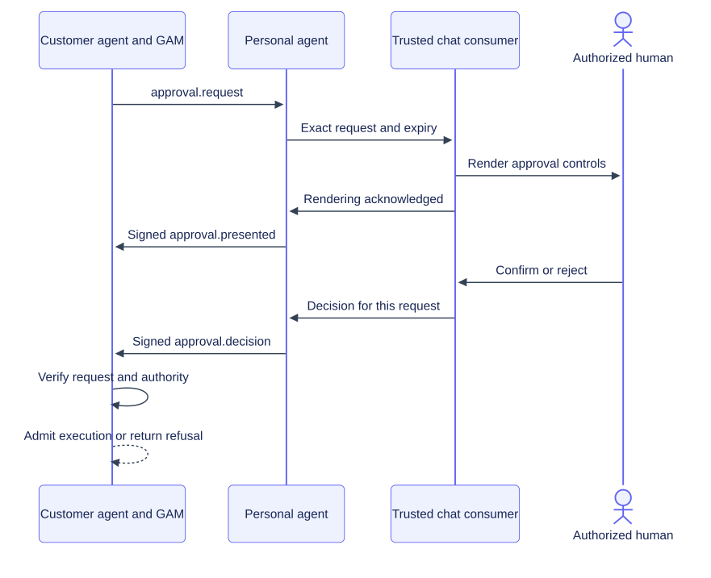

# External human approval

Managed GAM can require a different human's consent for an operation. The
customer and approver run separate AgentServers with independent GAM Domains.
The customer's original execution Mandate still controls admission; the external
response supplies consent Evidence for one frozen Presentation and show Act.

## From proposal to human decision



[Diagram source](assets/external-approvals-1.mmd).

The personal agent carries the request; its authenticated human consumer makes
the decision. The customer's Domain keeps execution authority. Each AgentServer
has its own Domain, and the transport can be a local adapter or Pulse.

## Run two agents without Pulse

From the core checkout, run:

```sh
mix run docs/examples/external_approval.exs
```

The example starts two real AgentServers, exchanges protocol maps through a
small mailbox adapter, and exercises both confirmation and rejection. It checks
that the Domains differ, the effect waits for consent, and replay is rejected.
The human consumer and browser effect are simulated; no browser or model is
needed. The core has no dependency on Pulse.

## Transport contract

Implement `c:Spectre.Server.GAM.Managed.Approval.send_message/2` and configure it
as `gam: [approvals: [transport: {MyApp.ApprovalTransport, options}, ...]]`.
The adapter sends a map and returns `{:ok, receipt}` or `{:error, reason}`.
An explicit `%{outcome: :not_sent}` error means delivery did not occur; other
delivery failures remain uncertain. A successful receipt proves neither rendering
nor consent. Authenticate the requester before passing inbound messages to
`Spectre.Server.receive_approval/2`; that public host API does not authenticate
the transport itself. Responses also require the configured human signature.

| Message | Meaning |
| --- | --- |
| `approval.request` | Frozen presentation, request id/revision, binding digests, Domain/Scope, exact show Act, intended human and expiry. |
| `approval.presented` | Signed acknowledgement from the human's trusted consumer that it rendered the exact request. |
| `approval.decision` | Signed `confirm` or `reject`, correlated to the complete request digest. |
| `approval.cancelled` | Authenticated requester notification that its wait closed. |

On the customer, configure `confirm: true, approver: {:external, address}` per
operation, and pin the approver's human Principal, address, Ed25519 public key,
approval authorization reference and expiry in `approvals.approvers`.
The personal Server configures the matching `approvals.signer`, including the
private key. Preserve keys and absolute expiry across durable restarts.

The owner's authenticated `consumer:` receives
`{Spectre.Server, personal_server, {:approval_request, request}}`. Render the
literal `request["rendered_payload"]`, with the requester and expiry visible,
then call `approval_presented/2`. An explicit human choice for that exact request
calls `approval_decide/3`. The model must never trigger those UI calls.

Use an operation-specific `message:` explaining the consequence. The standard
renderer includes the operation name, frozen arguments and bound context.
Request digests bind the data; they do not explain it to the person.
Bind both Lens `open` and `look` when navigation needs consent,
because `look(url)` can navigate too; govern `act` as appropriate to the host.

## Authority and recovery limits

`mandate_ref` in approval configuration names an authorization established by
the trusted host. It is not a remotely imported GAM execution Mandate, and the
signature attests the trusted chat host's message. Real human authentication
remains the host's responsibility. Dynamic cross-Domain Mandate discovery and
revocation are not supplied by this protocol.

The customer records the existing governed show Act before delivery. Only a
successful show can support response Evidence; an early signed decision waits
for show completion. Execution still uses the customer's Scope and Mandate.
Expired, conflicting, forged and consumed responses cannot authorize it.

Requests and exact signed replies reuse the managed coordination store. A
customer restart restores its consent wait suspended; resuming requires a fresh
Presentation/request. An approver can retry its stored exact choice after its
own durable restart. Cancellation is best effort; deadlines remain binding.

Transport calls run in supervised tasks, with at most 256 concurrent deliveries
per Gate and a timeout bounded by `gam: [show_timeout: milliseconds]` (default
20 seconds). A slow transport does not block the Gate or either AgentServer.
The rendering acknowledgement still has to arrive within the show timeout.

`approval_presented/2` and `approval_decide/3` return `:ok` after storing the exact
signed reply and queuing delivery. This is not a remote receipt. The consumer
subsequently receives:

```elixir
{Spectre.Server, personal_server,
 {:approval_delivery, %{request_id: id, message_id: message_id,
   type: type, status: status}}}
```

The technical status is `:accepted`, `:not_sent` or `:unknown`; none is consent
or proof of execution. There are no automatic network retries. Retry the same
UI call explicitly to resend its stored signature; a completed choice cannot
change. If a request delivery fails ambiguously or times out, retain that
uncertainty instead of claiming it was never displayed.

Tests exercise two independent Domains, slow delivery beyond five seconds,
failed replies, exact retries, deadlines and recovery without Pulse. The optional
Pulse suite also confirms and rejects approvals through real loopback HTTP
requests and authenticated REST ingress. Real account login, remote credentials
and a production deployment remain host responsibilities.

See [Automatic GAM](MANAGED_GAM.md#external-human-approval),
[the transport-independent tests](https://github.com/elchemista/spectre/blob/0.4.0/test/server/external_approval_test.exs)
and the optional [Pulse adapter guide](https://github.com/elchemista/spectre_pulse/blob/0.1.0/docs/EXTERNAL_APPROVALS.md).

## Inbox storage and application policy

The coordination Store is selected in this order: explicit `gam.store`, explicit
`checkpoint` adapter, a configured Stack resource providing
`{:spectre, :server_store, 1}`, then the built-in Store. Installing Ledger without
configuring its resource does not select a database. An external Store requires
durable GAM authority (`storage: {:disk, path}` or `storage: :ledger`); these remain
distinct contracts. With PostgreSQL Ledger, `:ledger` also puts canonical GAM
history and the restart profile in the database. See
[database authority storage](MANAGED_GAM.md#choose-persistence).
The inbox, signed responses, command journal and checkpoints reuse the selected
Store. Managed GAM does not allocate an unused `commands.store` beside it.

Requests have an atomic unique key `(receiver address, request id, sender address)`
and a canonical digest. Retransmission must preserve the complete immutable
request; conflicting content is rejected. The digest detects mutation, not sender
authenticity. Human replies use fenced CAS transitions; an explicit retry returns
the identical stored signature without writing another decision. There is no
in-memory copy of the complete inbox and no automatic deletion of database rows.

The authenticated consumer can read one entry or a bounded keyset page:

```elixir
reference = %{id: request["id"], from: request["from"]}
{:ok, entry} = Spectre.Server.approval(personal_server, reference)
{:ok, page} = Spectre.Server.approval_inbox(personal_server,
  status: :pending, limit: 50, max_bytes: 1_048_576)
# Continue until next_cursor is nil, including after an empty filtered page.
{:ok, next} = Spectre.Server.approval_inbox(personal_server,
  status: :pending, after: page.next_cursor)
```

`status` accepts `:all`, `:pending`, `:decided`, `:cancelled`, `:expired`.
Filtering applies to one bounded storage page; an empty result can still have a
continuation. Cursors are opaque, exclusive and namespace-bound. Reads are live
views, not a frozen snapshot. Limits bound read work (1–100 entries, at most
16 MiB), not inbox capacity. A single entry exceeding `max_bytes` reports
`:store_page_entry_too_large`. Custom Stores may implement the optional `list/3`
callback; otherwise pagination/recovery probes report `:store_list_unavailable`.
Use the full reference for direct fetch and replies with such adapters. A bare
request id is a convenience lookup and reports `:approval_reference_ambiguous`
when different senders used the same id.

After startup the consumer receives `{:approval_inbox, %{event: :recovered}}`
inside the normal Server event wrapper, or `:recovery_failed` if the bounded
probe failed. The UI pulls pages when needed; startup never scans the history.
Request notifications are at least once: retries can repeat the same pending
notification after a lost acknowledgement. Deduplicate UI items by full reference.
A Pulse `accepted` receipt still means neither rendering nor approval.

An optional application callback receives `:received`, `:duplicate`, `:presented`,
`:decided`, `:cancelled`, `:recovered`, `:recovery_failed`, and optional `:tick`
events. Configure `approvals: [maintenance_interval: milliseconds, ...]` to enable
ticks. Default behavior does no maintenance and has no timer. For example:

```elixir
def handle_approval_inbox(event, ctx) do
  # Private UI/policy state is volatile and does not write a checkpoint.
  put_private(ctx, :inbox_changed, event.event)
end
```

The callback runs in the Server: keep it short. Use normal worker/Actor commands
for I/O or host-owned scheduled maintenance; do not synchronously call the same
Server from its callback. Applications own display retention, archival queries
and optional quotas. Pruning a display cache must preserve canonical consent and
replay records. The callback cannot create approval Evidence or execution authority.

Inbox I/O runs in monitored supervised tasks. `io_workers` (default 4) bounds
concurrency, `io_timeout` (default 5000 ms) bounds waiting. A busy Store reports
`:approval_store_busy` for that request while the Server continues processing.
An interrupted/unknown write reports `:approval_storage_unknown`; retry the same
request identity instead of assuming it was never stored. Task completion,
timeout and owner termination release monitors/timers. The file Store still
retains its live values in RAM and has its documented capacity; use Ledger's
PostgreSQL ServerStore for a history that grows independently of owner memory.

The inbox/query and approval transport task supervisor is linked to its Gate.
Forced owner death also shuts down hung workers; normal cleanup is not dependent
solely on `terminate/2`. This async inbox boundary does not change the existing
synchronous checkpoint commit contract for ordinary Server state transitions.
Without an external database, the built-in ephemeral Store retains live records
in memory. It does not promise bounded memory for infinite history: select a
custom Store/policy or the PostgreSQL backend for that workload.

## Database outage policy

`handle_approval_inbox/2` also receives `:storage_error` events. The authenticated
consumer receives the same event inside `{:approval_inbox, event}`, even when the
callback returns `:default`. The event identifies `operation` (`:receive`, `:cancel`,
`:reply`, `:fetch`, `:list`, `:recover`), its `reference` when available, and `reason`.
Incoming requests include the original immutable `request`; cancellation includes
`message`, and replies include the requested `decision`. Adapter failures preserve
`{:approval_store, reason}`; lost/expired acknowledgements remain unknown.
A concurrency refusal also emits an event. Invalid messages or consent choices
are validation errors, not database outage events.

For example, an application can opt into a volatile, deduplicated retry queue:

```elixir
def handle_approval_inbox(%{event: :storage_error, operation: :receive,
                            request: request}, ctx) do
  key = {request["from"], request["id"]}
  queue = Map.put(get_private(ctx, :approval_retry, %{}), key, request)
  put_private(ctx, :approval_retry, queue)
end

def handle_approval_inbox(%{event: event, reference: ref}, ctx)
    when event in [:received, :duplicate] do
  queue = Map.delete(get_private(ctx, :approval_retry, %{}), {ref.from, ref.id})
  put_private(ctx, :approval_retry, queue)
end

def handle_approval_inbox(_, _ctx), do: :default
```

The host chooses whether/when to retry, use an alternative Store, show an outage
or apply a quota/backoff. Retry `receive_approval/2` with the same immutable request
from the trusted host after storage returns. Retry a reply with the same reference
and decision; if it previously committed, CAS lookup returns the identical signed
response. Do not change identity after a timeout. The canonical acquisition has
not been acknowledged merely because the callback buffered a request.

During `:storage_error`, the callback may change **private volatile state only**.
Durable assigns/commands require a checkpoint and are rejected before acquisition,
leaving the Server alive and reporting `:approval_callback_error`. The consumer
can display the technical event directly; a callback must not synchronously call
its own Server. No default infinite retry loop or unbounded fallback queue is
created. The sample queue is application policy: choose its memory retention and
backoff, and understand that a process crash loses it. The requester must retain
its request until acknowledged. Human presentation/consent is sent only after
canonical persistence, not from a volatile fallback.

A real PostgreSQL stop/start integration test exercises the outage hook, responsive
Server status, pool reconnection and retry with one canonical record. Additional
tests buffer a request privately, restore storage, obtain fresh human consent and
verify exactly one effect. Failures before Server startup still return a startup
error: no recovered authority/checkpoint can be invented while storage is absent.

This hook covers inbox I/O. With `storage: :ledger`, an unresolved ambiguous
**canonical GAM commit** retains the kernel's Domain halt semantics. The host
supervises restart with backoff when the database returns; it cannot grant consent
or execution from a volatile replacement authority. See
[database authority recovery](MANAGED_GAM.md#choose-persistence).
