# Application-owned payload storage

Configure `payload_store` to keep application content outside GAM history,
Domain projection rows and Server coordination records. The application chooses
its storage, encryption, retention and reference format. Spectre keeps portable
references alongside the facts needed to govern and recover work.

This is opt-in. Without this option, existing inline persistence continues;
Ledger installation alone does not encrypt or externalize content.

```elixir
Spectre.Server.start_link(
  agent: MyApp.Agent,
  identity: %{subject: account.id},
  consumer: self(),
  payload_store: {MyApp.Payloads, archive: MyApp.PrivateArchive},
  gam: [
    storage: {:disk, "var/agents/" <> to_string(account.id)},
    operations: allowed_operations
  ]
)
```

The same top-level option applies when using `gam: [storage: :ledger]` with
PostgreSQL. It controls payload placement independently of the canonical GAM
ledger and Domain projection adapters.



[Diagram source](assets/payload-storage-1.mmd).

The reference and governance facts stay in Spectre's records; the host decides
where the content lives and what guarantees its references provide.

## Two callbacks

```elixir
defmodule MyApp.Payloads do
  @behaviour Spectre.Payload.Store

  @impl true
  def put(bytes, context, opts) do
    archive = Keyword.fetch!(opts, :archive)
    archive.put(bytes, context)
  end

  @impl true
  def fetch(reference, context, opts) do
    archive = Keyword.fetch!(opts, :archive)
    archive.fetch(reference, context)
  end
end
```

`MyApp.PrivateArchive` is application code in this example, not a Spectre
adapter. Its `put/2` returns `{:ok, reference}`; its `fetch/2` returns
`{:ok, original_bytes}`. Either can return `{:error, reason}`. The runtime passes
encoded bytes so the adapter need not understand Spectre structs or schemas.

The reference can be a string, ID, object key, digest, tuple or plain map. It
must be portable data; process identifiers and executable values cannot be
persisted. There is no mandatory digest, signature, immutable-object service or
encryption algorithm. An S3 adapter, encrypted database adapter or application
service can implement the same behaviour. The adapter decides what guarantees
its references provide and must retain the content needed for its recovery
contract. Choose reference values that do not themselves disclose private data.

`context` is a small map describing the boundary. Current integrations use:

| `kind` | Content |
| --- | --- |
| `:operation` | Arguments, frozen execution identity/context and application policy material |
| `:presentation` | Rendered consent material |
| `:evidence` | Host-observed input and evidence payloads |
| `:receipt` | Detailed execution receipts |
| `:coordination` | Command journal and external approval inbox records |
| `:server_checkpoint` | Encoded Server snapshot, including assigns, history and pending work |

GAM contexts include `domain_ref`; coordination contexts use `domain` and `key`.
Checkpoint contexts contain the checkpoint `key` and available revision
information. Operation writes also include `command_id`; presentation writes
include `candidate_binding_ref`, and receipt writes identify their Act/Attempt
when available. The context is not an authority handle. Adapters may use it for
application routing or idempotency; put and fetch contexts need not have
identical revision fields.

## What remains in Spectre storage

Managed GAM externalizes application operation material, rendered
presentations, ingress payloads and detailed receipts before recording them.
Its command journal and approver inbox externalize their record values as
well. The Server checkpoint becomes a small reference envelope rather than an
inline copy of assigns, conversation and queued results.

GAM still records authority, operation classes, scope and principal references,
decisions, timestamps, revisions, causal links, consumed nonce digests and
outcomes. User-supplied identifiers, principal attributes, configured purposes
and other governance fields can themselves contain private information: use
application IDs and keep content in payloads. This option is not a semantic
scanner or a redactor for arbitrary application strings. Direct low-level GAM
users choose their own payload representation; the automatic transformations
belong to Managed GAM and Server coordination.

The Domain projection stores the resulting records and references, not another
copy of the external content. Runtime consumers resolve content when needed;
the canonical history and reference-bearing records remain the recovery facts.

## Workers, failures and recovery

Managed proposal, ingress, execution and inbox operations invoke the adapter
from their existing workers. They do not perform archive I/O inside the Domain
ordering process or add a permanent GenServer per payload. The adapter should
reuse its application's connection pools and may implement streaming or remote
storage internally. This API currently hands one encoded value to the adapter;
it is not a streaming interface for arbitrarily large files.

Checkpoint callbacks run in supervised tasks. Checkpoint acquisition remains
an ordered durability barrier: the Server waits for that task before releasing
work or acknowledging the transition. This does **not** make a Server waiting
for a slow checkpoint fully responsive. `payload_timeout` controls that wait
(default 30 seconds). There is no unbounded queue of background snapshots.

An adapter failure is returned through the current operation's error/recovery
path. Spectre does not silently write the content inline or retry an external
effect because its payload storage failed. After restart the same adapter must
resolve saved references. Missing content and unavailable storage are errors,
not empty successful reads. Stable configuration and application supervision
remain necessary for recovery.

External storage and the Spectre ledger do not share an automatic distributed
transaction. A successful content write followed by a failed Spectre commit can
leave unused objects. Deduplication, garbage collection, deletion and backup
policy belong to the application adapter. Return success only after storage has
met the guarantees the application expects.

This option applies to new writes. Existing inline events and saved records are
read for compatibility; enabling it does not remove content from old history,
database backups or another package's storage. Historical record residency is controlled separately by the Domain projection
store. See [Domain persistence and memory scope](DOMAIN_STORAGE.md).

## Profiling the storage boundary

The companion Ledger repository's `bench/otp_profile.exs` runs two independent
Domains and Skill Servers against an isolated PostgreSQL cluster. To exercise
this option with actual file I/O rather than moving payloads into another
process's memory, run from that repository:

```sh
SPECTRE_PATH=../spectre MIX_ENV=test ERL_FLAGS='+S 4:4' \
PROFILE_PAYLOAD_STORE=file PROFILE_BATCHES=20 PROFILE_BATCH_SIZE=500 \
PROFILE_IDLE_MS=30000 PROFILE_OUTPUT=/tmp/spectre-payload-profile \
mix run bench/otp_profile.exs
```

Its JSON includes process memory, reductions, binary bytes, mailbox lengths,
baseline/idle/teardown counts and encoded bytes in coordination, canonical GAM
and projection rows. External file count and byte size are reported separately.
The 10,000 inbox requests in this configuration are synthetic history entries;
the 21 approved operations exercise real two-Domain execution. These are finite
profiling measurements, not a proof of unlimited uptime or a production load
benchmark. The file adapter is a profiling fixture, not a supplied production
storage backend. See [Profiling](OTP_PROFILE_0_4.md) for the current workload measurements,
reproduction commands and their limits.
