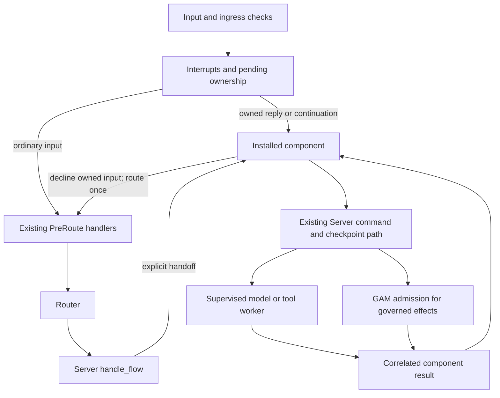

# Spectre 0.4.1 implementation plan

Status: proposed implementation plan, 2026-11-18. This document describes work
to implement and verify; it does not announce available APIs or a release.
It consolidates the runtime-component experiment, the subsequent Opus 5.5
reviews, and the requirements for PartIVA and `spectre_morph`.

## 1. Outcome and boundaries

Keep **Stack → Agent → Server**, with GAM governing declared effects. Make a
satellite installable once in the Stack and able to reuse the Server's command,
continuation and storage lifecycle through documented public contracts.

PartIVA must support an open conversation, a mission spanning many turns,
corrections and questions, and a long analysis while the user talks about
something else. An active continuation must be able to receive input without
classifying every message again. The router remains available for entry,
topic changes and ordinary application flows.

The release also connects declarative Skill evolution from `spectre_morph` to a
real AgentServer. A successfully activated Skill must actually run through that
Server and its GAM boundary.

Constraints:

- Reuse the existing Stack, router, pending, command/outbox, worker, Definition
  and storage mechanisms. Extend them where a concrete missing contract is shown.
- Keep RAM-only operation. Ledger and databases remain optional application choices.
- Keep slow model, tool and evaluation work out of coordinating callbacks.
- Keep application policy configurable: approval, timeouts, allowed tools,
  retention and recovery. Installing a package grants no extra authority.
- Preserve standalone satellite APIs and existing 0.4 applications.
- Add no `mission()` DSL, hidden second AgentServer, separate scheduler, journal,
  storage registry or arbitrary core-command escape hatch.
- Do not rewrite the GAM kernel or remove Instance/Run compatibility in this work.

## 2. Verified starting point

| Repository / area | Available now | Missing for this release |
| --- | --- | --- |
| Core, inspected at `9932f25` | Stack installation, tools/effects, Router.Adapter, Extension, pending lifecycle, workers, checkpoint/recovery, reset | Public installation-owned conversation/continuation dispatch and AgentServer evolution bridge |
| Directive, inspected at `e9f2065` | Pure reducer; Stack helper `new/next/respond/inform`; standalone runtime | Reusable AgentServer driver connecting reasoning, user answers, tools, GAM and results |
| Morph, inspected at `9db28de` | Data-only mount/replace/disable proposals, staged adapter workflow, capability detection | Public core boundary, real activation/recovery and execution of activated data Skills |
| Runtime experiment | Scoped component state, route bypass, detached workers, approval and disk-state examples | Final input ownership, protected delivery, complete correlation, background lifetime and production recovery |

The experiment passed seven example tests and 85 existing core tests. Two
additional diagnostics reproduced its limitations: a background chain stops
after 32 results, and a background worker inherits the configured worker timeout.
These results establish neither release readiness nor a memory plateau.

The current Morph bridge proposal and adapter were also read from GitHub:
[core proposal](https://github.com/elchemista/spectre_morph/blob/main/docs/CORE_0_4_1.md),
[adapter](https://github.com/elchemista/spectre_morph/blob/main/lib/spectre_morph/adapters/spectre.ex).
The default adapter currently returns `:agent_server_evolution_unavailable` on
0.4.0. Its test adapter does not establish real AgentServer activation.

## 3. One installation entry point, optional extension contracts

Extend `Spectre.Stack.Installable`; do not create a competing plugin system.
Retain `tools/1`, `effects/1`, `child_specs/2` and `agent_extensions`. Add an
optional, versioned **component descriptor** only for libraries that need to own
conversation state and receive continuations.

Proposed shape, subject to the contract tests in phase 0:

```elixir
@impl Spectre.Stack.Installable
def component(_config) do
  %{contract: 1, module: MyLibrary.Conversation}
end
```

Validate the descriptor at installation/Server binding time. Reuse installation
identity and configuration; do not introduce another registry or duplicated
configuration tree. Packages without a component remain unchanged.

| Extension need | Public contract to use |
| --- | --- |
| Recognize input using a library-specific method | Existing `Spectre.Router.Adapter` |
| Add namespaced compile-time declarations | Existing `Spectre.Extension` through `agent_extensions` |
| Own a conversation or correlated workflow | Proposed optional `component/1` and `Spectre.Server.Component` |
| Request a tool or register a governed effect | Existing `tools/1`, `effects/1`, validated Server command path |
| Own an optional resource/process | Existing `child_specs/2` and explicit Stack runtime |
| Supply storage, memory or model services | Existing specialized provider behaviours |
| Activate a new agent Definition | Proposed typed `Spectre.Server.Evolution` boundary |

A package implements only what it uses. Mnemonic and Ledger need not handle
chat events. A third-party invoice integration must work without changing core.
New libraries using these capabilities require no package-specific runtime
branches. A fundamentally new core invariant may still require a separately
versioned contract; the interface is not permission to mutate arbitrary internals.

## 4. Router integration and conversation ownership

Keep recognition and execution separate. A router adapter contributes evidence
for visible declared routes; the configured router arbitrates. Application
configuration selects adapters, thresholds and the routing vocabulary.

Start with a small public handoff helper inside the existing Server callback:

```elixir
# Proposed 0.4.1 API; Component.route/4 is not available in 0.4.0.
def handle_flow({:fatture, _} = route, input, ctx) do
  Spectre.Server.Component.route(ctx, :directive, route, input)
end
```

This is an entry binding, not the mission loop. The driver belongs to Directive.
An application can also explicitly bind an unrecognized input to the component
to provide an open assistant. It must distinguish a genuine no-match from a
router/provider failure: today both reach `handle_flow(:unmatched, ...)`, with
the error described in routing metadata. Preserve that distinction in the
helper/example rather than silently starting a mission on classifier failure.

Do not add `flow ..., to:` in the first implementation. Revisit it only if the
working helper demonstrates a meaningful ergonomic need. `mission()` is excluded.
Do not implicitly give every installed library first access to every input.

### Required input ordering

1. Existing input preparation and mandatory ingress checks.
2. Global interrupts under the existing pending-lifecycle policy.
3. An explicitly targeted/foreground pending, including its identity/revision.
4. Existing PreRoute handlers when ordinary routing is reached.
5. Router and its current-flow preference.
6. Application callback or explicitly selected component.

The component cannot silently move ahead of existing interrupts, consume another
owner's wait, or treat an ordinary answer as GAM approval. Consent and a mission
question remain different pending kinds with their existing authority checks.

### Design gate: free conversation without repeated routing

`current_flow` prioritizes candidates; it does not own the next message. Test
reuse of the existing reply-pending mechanism for an active conversational
continuation, including turns that are not answers to a narrow question.
The conversation may remain active while a particular worker is absent.

The required scenario is: mission → free correction → question → topic change →
help → explicit resumption → answer. A component can return `:cont` or
`{:cont, ctx}` for input it declines, suspending its own conversational wait and
routing that same input once. No commands accompany the state-only `:cont` form.
Those returns are not a loop back to routing after a route has already selected
the component. Errors are not converted into continuation.

Prefer existing pending ownership over a second global focus map. If it cannot
represent the required dialogue cleanly, extend that ownership contract minimally
and explicitly; do not discard the bypass requirement just to remove a field.
Document the decision and passing scenarios before freezing the interface.



## 5. Server component and continuation contract

Use a small behaviour with `handle(event, ctx)`. Initial proposed events:

- `{:route, route_key, input}`: entry explicitly selected by the application.
- `{:reply, request_id, input}`: an input owned by this component's wait.
- `{:result, tag, result}`: completion of its previously staged command.

Returning a Context stages ordinary Server commands and local state. The
runtime acquires both through its existing validation/checkpoint/outbox path.
The component's assigns are namespaced by installation. Identity, authority,
session, another component's state and runtime-owned fields are not replaced by
the returned context. This is trusted application code, not a code sandbox.

Deliver owned replies/results in the runtime below application catch-all
callbacks. A custom `handle_result`, `handle_pending` or `handle_info` must not
silently disable a satellite. Ordinary application events retain their callbacks.
Keep strict application assigns/result schemas compatible with internal component
state and envelopes; do not force applications to declare private runtime keys.

Normalize pending identities and continuation tags at the boundary. Bind results
to installation, session, request and applicable revision using existing command
and event identities. Mark transitions in flight atomically when acquired;
discard duplicates or superseded results before applying a reducer transition.
Define an explicit stale-result outcome for a removed installation.

Component helpers use installed descriptors and existing commands. Host policy
may narrow a component's tool/operation access; reuse existing Skill restrictions
and provenance where applicable. Do not duplicate GAM or require a new role system.
Validate ownership of pending-resolution commands as well as ordinary tool calls.

Use the existing checkpoint/store and reset API. Reset invalidates old
continuations and clears component state. Define reset of affected work,
component removal and state-schema compatibility explicitly; restored data
must never be silently interpreted using an incompatible component contract.

## 6. Background lifetime, recovery and memory

Separate conversational ownership from work lifetime. Releasing a conversation
does not cancel its analysis; receiving a late result does not seize another
foreground wait. Background questions follow the existing pending scheduling
policy instead of replacing an active consent prompt.

Reuse supervised workers, outbox/inbox and stable correlation. Give background
continuations a lifetime and step-budget scope distinct from the completed
foreground interaction. Preserve a configurable loop budget and explicit
timeouts; neither the inherited 32-step interaction limit nor an implicit
infinite timeout is a satisfactory mission policy.

Cancellation must distinguish work not started, a running cancellable worker,
and a governed effect already admitted or of uncertain outcome. A cancelled
conversation cannot undo an external effect. Reject stale completions after
cancellation/reset without blind retries of nonrepeatable effects.

Persist only current state, necessary continuations and existing durable records.
Do not retain every Context, worker reference or historical mission snapshot in
assigns. Slow I/O and expensive evaluation use workers; coordinating callbacks
remain short. Use existing cleanup/retention hooks for terminal state and
completed correlations. Developer choices remain explicit.

RAM-only works without a DB. With persistence, use existing storage recovery and
degradation policy. On unavailable/pruned storage, expose retry or a deliberate
fresh RAM session; do not invent missing authority, approvals or successful
activation. A RAM fallback is volatile and must not report a durable commit.
Existing unaffected conversation capabilities should remain usable where safe.

Profile completed and active workloads separately: process/ETS/binary memory,
reductions, mailbox depth, worker count, checkpoint size, I/O count and response
latency. Use repeated equal-size batches after warm-up and post-GC baselines to
identify retained growth. Measure 1/10/100 agents, long conversations, more than
32 mission steps, repeated reset/cancel, and storage outage/recovery. Report the
payload and retention settings. Compression/hibernation are measured options,
not substitutes for releasing retained state.

## 7. Complete Directive inside its package

Move the experiment's reusable driver into `spectre_directive`, using the public
component contract. Keep the pure reducer and standalone runtime available;
Stack integration must not start that second runtime implicitly.

| Directive request | Driver action through Server |
| --- | --- |
| `:reason` | Use the configured model service; validate the decision protocol before applying it |
| `:question` | Open an owned reply wait; handle answer, topic change and resumption |
| `:confirmation` | Apply the configured mission confirmation policy; do not equate plan approval with GAM consent |
| `:policy` | Call the host-selected policy handler and preserve refusal/blocked outcomes |
| `:invoke` | Resolve an installed/host-declared target and stage its cognitive or governed command |

Feed observed results back into the exact reducer request. Support `:done`,
`:blocked`, `:error`, malformed model output, cancellation and resumption as
explicit states. Reuse existing Directive parsing and request-handler logic
where it fits; do not copy its standalone runtime into Server.

Keep target/model selection under host configuration. Model output cannot choose
an arbitrary MFA or bypass an operation's GAM path. Do not report an uncertain
effect as a completed step. Make the current 900,000-byte serialized-state limit
visible, measure history growth and reuse retention/projection facilities before
claiming support for indefinitely growing missions.

## 8. Complete Morph and the AgentServer evolution boundary

Reuse `SpectreMorph`, `Operation`, `Adapter` and the prepared default adapter.
Implement its proposed public core capability:

```elixir
# Proposed boundary already expected by spectre_morph; absent from core 0.4.0.
Spectre.Server.Evolution.contract_version() # 1
Spectre.Server.Evolution.call(target, action, request, opts)
# {:ok, result_map} | {:error, reason}
```

Actions are the existing `:snapshot`, `:evaluate`, `:approve`, `:reject` and
`:activate`. This is a typed evolution boundary, not an arbitrary runtime-call API.
Keep capability detection and explicit unavailable errors compatible with 0.4.0.

Implementation requirements:

- Reuse `Skill.Definition`, ChangeSet operations/evaluation, Definition storage,
  Skill runtime and existing authority/GAM checks. Extract small shared functions
  from Instance-bound code if necessary; do not redirect to a hidden Instance.
- Authenticate the caller through the host boundary. `by:` remains attribution.
  Human approval is required only when the host's policy requires it.
- Bind snapshot, candidate and approval to the same evolution-relevant revision:
  session/reset generation, active Definition and applicable mount authority.
  A routine checkpoint write revision is not sufficient.
- Support mount, replacement and disable of declarative runtime Skills. Preserve
  ceilings, compiled mount protection and existing route-conflict checks.
  No executable modules or callbacks are authored in model data.
- Run expensive evaluation in supervised work. Server callbacks stage commands;
  they must not synchronously call Evolution on their own GenServer.
- Begin activation at an idle boundary for the affected mount. Return `:busy`
  when its pending/work/outbox still depends on it; keep unrelated chat running.
- Define the durable activation commit and recovery sequence before implementing
  success responses. Coordinate Definition artifacts, existing store CAS and
  GAM records without assuming cross-store atomicity. Retry/lost-response recovery
  must identify the same attempt rather than apply the change again.
- Connect data Skills to actual Server execution: replies become responses,
  operation requests enter the existing registered/GAM path, and work responses
  use the existing Execution contracts with exact Definition/program references.
  Evaluation rejects unsupported handler kinds before approval/activation.
- Exercise reset, concurrent activation, stale receipts, revoked authority,
  missing Definition data and crash recovery. Never restore an old authorization
  into a new session or silently activate a partial candidate.

Add a thin Stack installable adapter to `spectre_morph` for its optional Server
helpers/effects, leaving the `SpectreMorph` proposal API usable directly. It need
not be a conversation component. Approval and activation remain authoritative
core operations even when requested by a model-driven component.

Acceptance must include real input to the same AgentServer after mount, replace
and disable. A stored candidate or successful fake adapter receipt is insufficient.
Keep existing `Spectre.Morph` compatibility APIs unchanged.

## 9. Satellite adoption and future extensibility proof

| Package | Intended use of the common interfaces |
| --- | --- |
| Directive | Component driver plus existing reducer tools |
| Morph | Typed evolution bridge; optional Stack facade |
| Kinetic | Existing interpretation/tools/effects; reusable from a component |
| Prism | Existing model selection/service integration; model work in workers |
| Mnemonic | Existing standalone memory/provider and explicit tools/effects |
| Lens | Existing tools/resources/effects; preserve each operation's declared governance |
| Beam / Pulse | Existing transport tools/effects and correlated delivery; technical receipt is not consent |
| Ledger | Existing storage/projection providers; no chat component required |
| Lab | Existing diagnostics/tools; optional interactive component only if needed |
| Third-party invoice library | Public Installable/tools/effects and optionally Router.Adapter; no core patch |

Audit compatibility and make only necessary adapter changes. Do not rewrite all
satellites into components or couple their standalone APIs to Directive.
Place real satellite integration tests in their repositories or
`spectre_ecosystem`; the core suite uses small contract fixtures and runs without
satellite dependencies.

## 10. Delivery order and acceptance gates

| Phase | Deliverable | Exit condition |
| --- | --- | --- |
| 0 — Contract experiment | Explicit component entry, owned replies, bypass/topic-change comparison | Free PartIVA dialogue and router coexist; input order and return meanings decided; no additional DSL |
| 1 — Core integration | Optional descriptor, scoped state, protected result delivery, correlation, background lifecycle | Contract tests pass with no satellites installed; ordinary callbacks and schemas remain compatible |
| 2 — Directive | Reusable driver, all request/result kinds, open-chat and routed examples | Real reducer/model-service/tool loop works without an application-written continuation loop |
| 3 — Morph | Versioned boundary, activation/recovery and data-Skill execution | Same live AgentServer uses mounted/replaced/disabled Skill; stale/concurrent/failed activation cannot apply |
| 4 — Integration and performance | Satellite compatibility, ecosystem scenarios, storage failures and profiling | Required failure scenarios pass; measured memory/latency regressions investigated and documented |
| 5 — Documentation and release checks | Guides, runnable examples, API contracts, mix tasks/doctor coverage | Documentation and generators describe the tested 0.4.1 interfaces; all applicable quality checks pass |

Required test matrix:

- Route-selected component and explicitly configured open assistant; no-match
  distinguished from provider error; one routing pass after a declined reply.
- Free conversation without repeated routing, correction, help/cancel interrupt,
  suspended wait and resumption; GAM consent remains correctly correlated.
- Application callback catch-alls and strict schemas do not break component delivery.
- Two installations using the same local tags remain isolated; stale session,
  duplicate result and superseded revision cannot advance another continuation.
- Held background worker while a different chat request completes; a mission
  exceeding 32 steps; timeout, worker crash, cancellation and late result.
- Reset/restart during a wait and during work; disk restoration; removed or
  incompatible component. Verify actual continuation recovery, not just saved assigns.
- Governed effect approved, refused, expired, unauthorized and uncertain; same
  admission rules with routed and directly owned input. Include transport-independent
  approval and Pulse integration in their appropriate suites.
- Morph mount/replace/disable followed by actual input, affected-mount busy,
  duplicate activation, reset race, forged/stale approval and loss of the reply.
- RAM-only, disk and existing Ledger/Postgres adapters with a real database in
  the appropriate integration project: outage, restoration, missing/pruned records
  and explicit fresh-RAM recovery. No fabricated durable success.
- Third-party invoice library and router adapter integrated using public contracts
  only; core tests continue to run independently of every satellite package.

Use deterministic model/SDK fixtures for the normal suite and one opt-in real
model end-to-end check when credentials are available. Label the evidence clearly.
Run formatter, compilation with warnings as errors, tests/coverage, strict Credo,
Dialyzer and documentation checks for changed packages. Keep the configured
coverage threshold; do not add implementation-mirroring tests to chase a new number.
CI remains PR-triggered without duplicate push runs. Do not expand unrelated jobs.

## 11. Documentation deliverables and definition of done

Update [Server callbacks](SERVER_CALLBACKS.md), [AgentServer](AGENT_SERVER.md),
[routing](ROUTING.md), [Stack tools](STACK_TOOLS.md),
[behaviours](BEHAVIOURS.md), [Skills](SKILLS.md),
[Managed GAM](MANAGED_GAM.md) and the affected storage/production guides.
Add the component contract and a short 0.4.0-to-0.4.1 guide. Update Directive and
Morph guides with tested APIs; later synchronize ecosystem examples and the
documentation site from these sources.

Show Stack → Agent → Server code in that order. For every handler, show who calls
it, input shape, return shape, command/result tag connection, state owner and
whether slow work runs in a worker. Document pending/interrupt/route order with
a diagram. Mark optional providers and distinguish current APIs from proposals.

Include runnable examples for: ordinary routing; open assistant; background
invoice analysis and governed issuance; a custom Installable/Router.Adapter;
Morph activation on a live AgentServer; standalone satellite usage. Review mix
task generation/training/doctor examples against the actual new architecture;
doctor should identify a missing/incompatible component or evolution capability.

The release is ready when the acceptance scenarios, recovery tests and documented
profiling pass, compatibility remains intact, and the public contract is small
enough to explain through these examples. Passing the experimental tests alone
does not satisfy this gate. Commit/push, tagging and Hex publication are separate
release actions; this planning change performs none of them.
